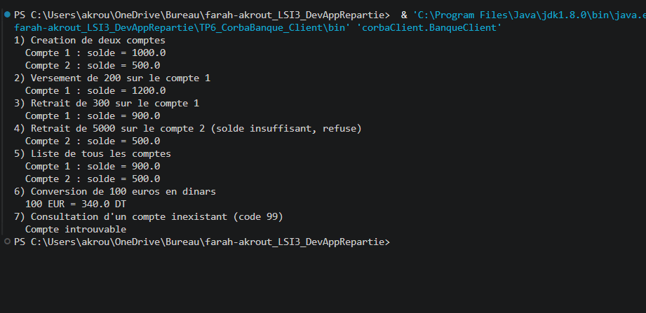

# TP6 : Service Banque en CORBA

**Étudiante :** Farah Akrout
**matière:** Développement d'applications réparties
**Activité :** TP6, communications client-serveur avec CORBA

---

## 1. Objectif

Réaliser une application distribuée client-serveur en Java avec le middleware **CORBA** (Common Object Request Broker Architecture) pour gérer des comptes bancaires.

Un serveur gère l'ensemble des comptes. Chaque compte est défini par un **code** et un **solde**. Le serveur permet aux clients d'effectuer, à distance, les opérations suivantes :

| Opération | Méthode IDL |

| Créer un compte avec une somme initiale | `creerCompte(in Compte cpte)` |
| Verser une somme sur un compte | `verser(in float mt, in long code)` |
| Retirer une somme d'un compte | `retirer(in float mt, in long code)` |
| Consulter un compte | `getCompte(in long code)` |
| Consulter la liste de tous les comptes | `getComptes()` |
| Convertir un montant d'Euro (€) en Dinar Tunisien (DT) | `conversion(in float mt)` |

## 2. Environnement

- JDK 8 (version 1.8.0, avec le compilateur IDL `idlj` 3.2)
- Visual Studio Code (avec l'extension Extension Pack for Java)

## 3. Structure du dépôt

```
farah-akrout_LSI3_DevAppRepartie/
├── README.md
├── captures/                      (captures d'écran du README)
├── TP6_CorbaBanque_Server/
│   └── src/
│       ├── Banque.idl
│       ├── jndi.properties
│       ├── corbaBanque/
│       ├── service/BanqueImpl.java
│       └── corbaServer/BanqueServer.java
└── TP6_CorbaBanque_Client/
    └── src/
        ├── Banque.idl
        ├── jndi.properties
        ├── corbaBanque/
        └── corbaClient/BanqueClient.java
```

---

## 4. Étape 1 : Préparation de l'espace de travail

Vérification de l'environnement : le JDK 8 est installé et configuré dans le PATH. Les commandes `java -version` et `idlj -version` répondent correctement.


---

## 5. Étape 2 : Développement du serveur

### 5.1 Création du projet

Création du projet Java `TP6_CorbaBanque_Server`. La capture montre son contenu après la compilation de l'IDL : le dossier `corbaBanque` (code généré par `idlj`), le servant dans le package `service`, le serveur dans le package `corbaServer`, ainsi que `Banque.idl` et `jndi.properties` dans `src`.


### 5.2 Interface IDL

Le fichier `Banque.idl` (dans `src`) déclare :

- le module `corbaBanque` ;
- la structure `Compte` (`code` de type `long`, `solde` de type `float`) ;
- le type `tabComptes`, une séquence de comptes (`typedef sequence<Compte> tabComptes`) ;
- l'interface `IBanqueRemote` avec les méthodes distantes `creerCompte`, `verser`, `retirer`, `getCompte`, `getComptes` et `conversion`.


### 5.3 Implémentation du servant

La classe `service.BanqueImpl` hérite de `IBanqueRemotePOA` et implémente les méthodes de `IBanqueRemoteOperations`. Les comptes sont stockés dans une `HashMap` indexée par le code du compte.

- `creerCompte` enregistre un nouveau compte.
- `verser` ajoute un montant positif au solde.
- `retirer` retire un montant positif seulement si le solde est suffisant.
- `getCompte` renvoie le compte demandé, ou un compte de code `-1` s'il n'existe pas (CORBA ne peut pas transmettre `null` pour une structure).
- `getComptes` renvoie le tableau de tous les comptes.
- `conversion` convertit un montant en euros en dinars avec un taux fixe de 3,40 DT pour 1 €.

### 5.4 Configuration JNDI

Le fichier `jndi.properties` (dans `src`) indique l'adresse de l'annuaire de noms :

```
java.naming.factory.initial = com.sun.jndi.cosnaming.CNCtxFactory
java.naming.provider.url = iiop://localhost:900
```

### 5.5 Développement du serveur

La classe `corbaServer.BanqueServer` :

1. initialise l'ORB ;
2. récupère la référence du `RootPOA` et active le `POAManager` ;
3. configure l'annuaire JNDI (lecture de `jndi.properties`) ;
4. crée le servant `BanqueImpl` ;
5. enregistre sa référence dans l'annuaire sous le nom `BanqueService` ;
6. met l'ORB en attente des requêtes des clients (`orb.run()`).

---

## 6. Étape 3 : Développement du client

1. Création du projet Java `TP6_CorbaBanque_Client`.
2. Copie de `Banque.idl` et de `jndi.properties` dans `TP6_CorbaBanque_Client/src`.
3. Nouvelle compilation de l'IDL dans le projet client avec `idlj -fall -v Banque.idl` : le package `corbaBanque` est généré.
4. Création de la classe `corbaClient.BanqueClient`, qui :
   - récupère les propriétés de l'annuaire JNDI ;
   - récupère la référence de l'objet distant (`ctx.lookup("BanqueService")`) ;
   - la convertit en stub avec `IBanqueRemoteHelper.narrow(...)` ;
   - appelle à distance chacune des méthodes du service bancaire pour les tester.


---

## 7. Étape 4 : Exécution de l'application

L'exécution respecte l'ordre d'initialisation : annuaire, puis serveur, puis client.

### 7.1 Lancement de l'annuaire de noms

La commande `tnameserv` lance la classe `TransientNameServer`. Sur ma machine, elle annonçait l'adresse réseau du poste (`10.26.13.162`), qui n'était pas joignable (message `Connection timed out`). J'ai donc lancé la même classe directement, en forçant l'adresse locale `127.0.0.1`, sur le port 900 prévu dans `jndi.properties` :

```
java "-Dcom.sun.CORBA.ORBServerHost=127.0.0.1" com.sun.corba.se.impl.naming.cosnaming.TransientNameServer -ORBInitialPort 900
```

L'annuaire affiche son contexte de dénomination initial, configure le port 900, puis indique **Prêt**.


### 7.2 Lancement du serveur

Exécution de la classe `BanqueServer`. Pour la même raison que ci-dessus, l'ORB du serveur est initialisé avec la propriété `com.sun.CORBA.ORBServerHost` fixée à `127.0.0.1`, afin que la référence enregistrée dans l'annuaire soit joignable. Le serveur affiche « Serveur Banque prêt, en attente des clients... ».


### 7.3 Lancement du client

Exécution de la classe `BanqueClient`, qui teste chaque méthode distante.



---

## 8. Résultats des tests

| N°  | Test                                                | Résultat obtenu                    |
| --- | --------------------------------------------------- | ---------------------------------- |
| 1   | Création du compte 1 (1000) et du compte 2 (500)    | Soldes 1000.0 et 500.0             |
| 2   | Versement de 200 sur le compte 1                    | Solde 1200.0                       |
| 3   | Retrait de 300 sur le compte 1                      | Solde 900.0                        |
| 4   | Retrait de 5000 sur le compte 2 (solde insuffisant) | Retrait refusé, solde 500.0        |
| 5   | Liste de tous les comptes                           | Compte 1 : 900.0, compte 2 : 500.0 |
| 6   | Conversion de 100 € en dinars                       | 340.0 DT                           |
| 7   | Consultation du compte inexistant 99                | « Compte introuvable »             |

## 9. Remarques

- Le taux de conversion Euro vers Dinar est fixe (3,40) et sert uniquement à la démonstration.
- Un retrait supérieur au solde est ignoré par le serveur : le solde reste inchangé.
- Les données sont conservées en mémoire : elles sont perdues à l'arrêt du serveur.

## 10. Lancer le projet

1. Lancer l'annuaire (voir section 7.1) et laisser le terminal ouvert.
2. Exécuter `TP6_CorbaBanque_Server/src/corbaServer/BanqueServer.java`.
3. Exécuter `TP6_CorbaBanque_Client/src/corbaClient/BanqueClient.java`.
